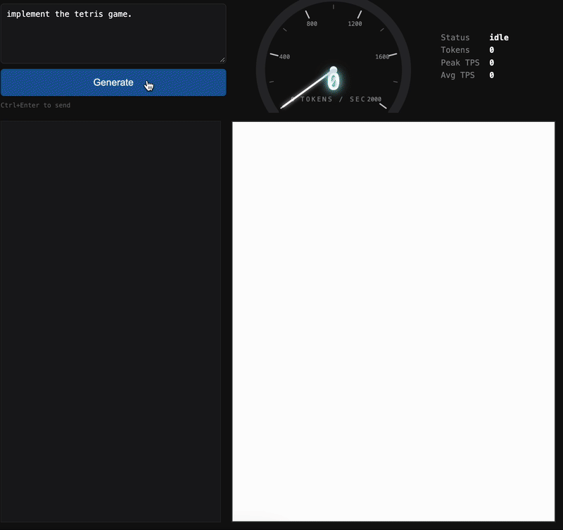

# DeepSeek Ultrafast

An ultra-fast inference engine for **DeepSeek-V4.1-Flash** for `sm_100a` and `sm_103a`. It supports 1M context length and multi-server KV cache sharing.

## Performance

| | 4 x GB300 (TP4) | 8 x B300 (TP8) |
|---|---|---|
| **Decode** (coding) | **1,740 tokens/s** | **2,060 tokens/s** |
| **Step time** | **3.30 ms** | **2.71 ms** |
| **Acceptance length** | **5.6 tokens/step** | **5.7 tokens/step** |
| **Prefill** | **1,000,000 tokens in 13.2 s** (76,000 tokens/s) | **1,000,000 tokens in 11.7 s** (85,000 tokens/s) |

Decode, step time and acceptance length are measured on *"implement the tetris game. output HTML code directly - no explanation."* Each decode step drafts a block of tokens and verifies it; the acceptance length is the average number of tokens a step emits. Instructions for reproducing the results are at the bottom of this page.

<p align="center">
  
  <br>
  <em>Streaming a complete Tetris game, with live decode speed, then playing it. Shown at real-time speed.</em>
</p>

DeepSeek-V4.1-Flash-Fast is available on [Baseten Model APIs](https://www.baseten.co/products/model-apis/). More performance improvements and open source releases are coming.

## Quickstart

### Requirements

- 4 GB300 (`sm_103a`), 4 or 8 B300 (`sm_103a`) or 4 or 8 B200 (`sm_100a`) GPUs
- The CUDA 13 toolkit
- [DeepSeek-V4.1-Flash](https://huggingface.co/deepseek-ai/DeepSeek-V4.1-Flash) in `models/`
- A Redis instance for multi-server KV cache coordination

```sh
sudo apt-get install -y build-essential pkg-config cmake clang libclang-dev \
    libibverbs-dev librdmacm-dev libopencv-dev redis-server curl ca-certificates
curl -sSf https://sh.rustup.rs | sh -s -- -y --default-toolchain none && . "$HOME/.cargo/env"
```

### 1. Build

```sh
rustup toolchain install
DSUF_SM=sm_103a cargo build --release -p deepseek-ultrafast-engine --bin run -p deepseek-ultrafast-server --bin serve
```

### 2. Start a local server

The server keeps each conversation's KV cache between turns. Redis records which replica owns
each conversation's cache; locally it only needs to be running. The server finds the machine's
RDMA ports itself:

```sh
redis-server --bind 127.0.0.1 --save '' --appendonly no --daemonize yes

DSUF_REDIS_URL=redis://127.0.0.1:6379 target/release/serve --ckpt models --gpus 0,1,2,3 --port 8000
```

On an 8-GPU B300 machine, use all eight (`--gpus 0,1,2,3,4,5,6,7`; build with `DSUF_SM=sm_103a`).

It is ready when `curl localhost:8000/readyz` returns 200, about 20 seconds after start.

### 3. Connect your harness

Use your favorite OpenAI-compatible client. For example:

```sh
DEEPSEEK_BASE_URL=http://localhost:8000 DEEPSEEK_API_KEY=none \
    npx @deepseek-ai/dsh headless "summarize this repo"
```

## KV cache sharing in multi-server setups

Every server keeps recent conversations' KV caches in host memory. When a conversation's next turn
lands on a different server, that server fetches the cache directly from the server that holds it,
host memory to host memory over RDMA, instead of recomputing the prompt. Redis records which server
owns each conversation's cache and announces ownership changes.

Thanks to DeepSeek's extreme KV cache compression, the transfers are very fast and can be done on every request.

This setup removes the need for prefix-aware routing and enables better load balancing.

See [deploy/kubernetes.yaml](deploy/kubernetes.yaml) for an example multi-server deployment.

## Reproduce the demo

Stream the Tetris answer from the server and report the decode speed:

```sh
python3 - <<'EOF'
import json, time, urllib.request

body = {
    "model": "deepseek-v4.1-flash",
    "messages": [{"role": "user", "content": "implement the tetris game. output HTML code directly - no explanation."}],
    "thinking": {"type": "disabled"},
    "stream": True,
    "stream_options": {"include_usage": True},
}
req = urllib.request.Request("http://localhost:8000/v1/chat/completions", json.dumps(body).encode(),
                             {"Content-Type": "application/json"})
start, first, tokens = time.time(), None, 0
with urllib.request.urlopen(req) as stream:
    for line in stream:
        if not line.startswith(b"data: {"):
            continue
        chunk = json.loads(line[6:])
        if chunk.get("usage"):
            tokens = chunk["usage"]["completion_tokens"]
        for choice in chunk["choices"]:
            if text := choice["delta"].get("content"):
                first = first or time.time()
                print(text, end="", flush=True)
end = time.time()
print(f"\n\n{tokens} tokens at {tokens / (end - first):,.0f} tokens/s (first token after {first - start:.2f} s)")
EOF
```

It ends with a line like `5142 tokens at 1,717 tokens/s (first token after 0.04 s)`.

We see 1,700-1,770 tokens/s on 4xGB300 and 1,980-2,170 tokens/s on 8xB300 (`--gpus 0,1,2,3,4,5,6,7`).

The server's `request_end` log line reports each request's step time (`average_iteration_ms`) and acceptance length
(`average_accept_length`). Over 30 runs we see 3.24-3.37 ms and 5.1-6.1 tokens/step on 4xGB300, and 2.69-2.74 ms and
5.3-6.1 tokens/step on 8xB300.

## Third-party libraries

- [deepseek-recipe](https://github.com/deepseek-ai/deepseek-recipe): prompt rendering and response parsing
- [tokenizers](https://github.com/huggingface/tokenizers): tokenization
- [cuDNN](https://developer.nvidia.com/cudnn) and [cuBLAS](https://developer.nvidia.com/cublas): the vision encoder
- [OpenCV](https://opencv.org): image decoding
- [Velo](https://github.com/ai-dynamo/velo): KV transfer between replicas over RDMA

## Acknowledgments

The kernels were optimized by coding agents that could read the source of
[FlashInfer](https://github.com/flashinfer-ai/flashinfer) and [SGLang](https://github.com/sgl-project/sglang)
while they worked.
